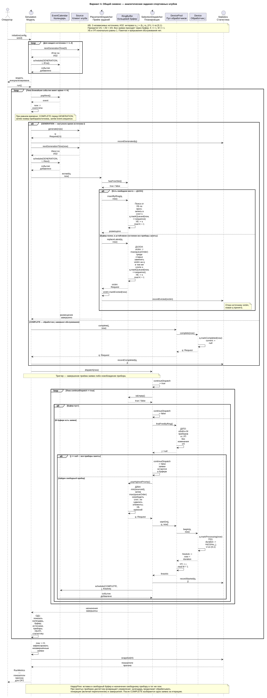
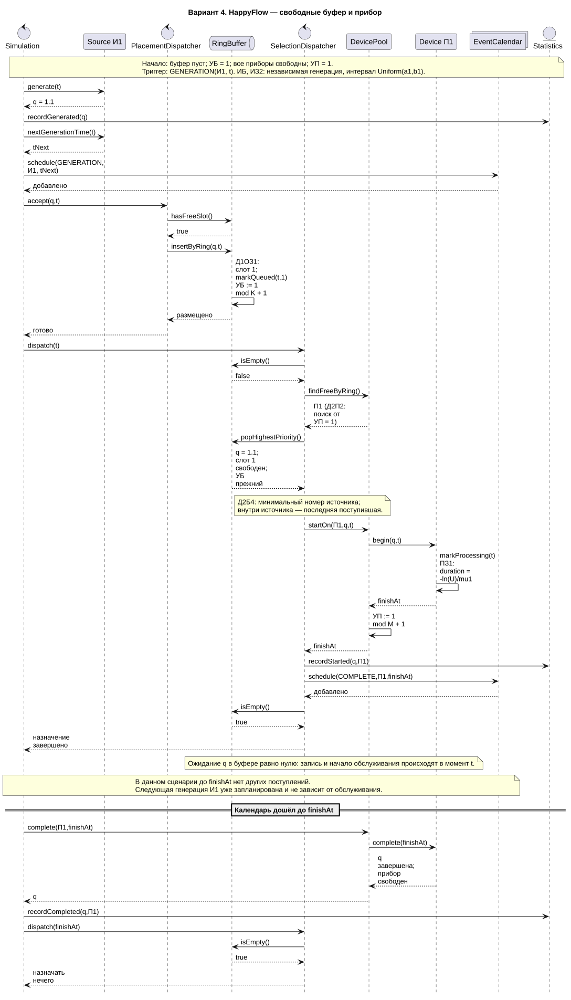
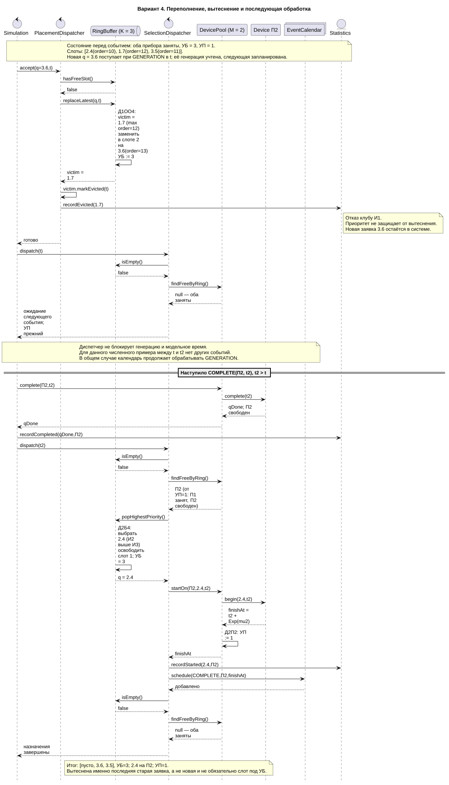
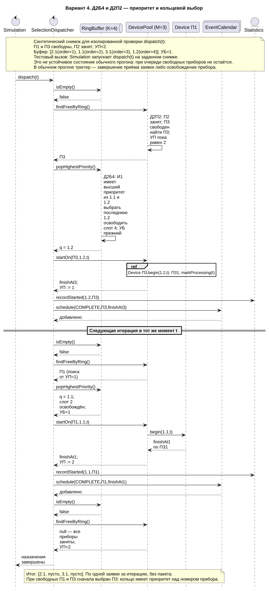
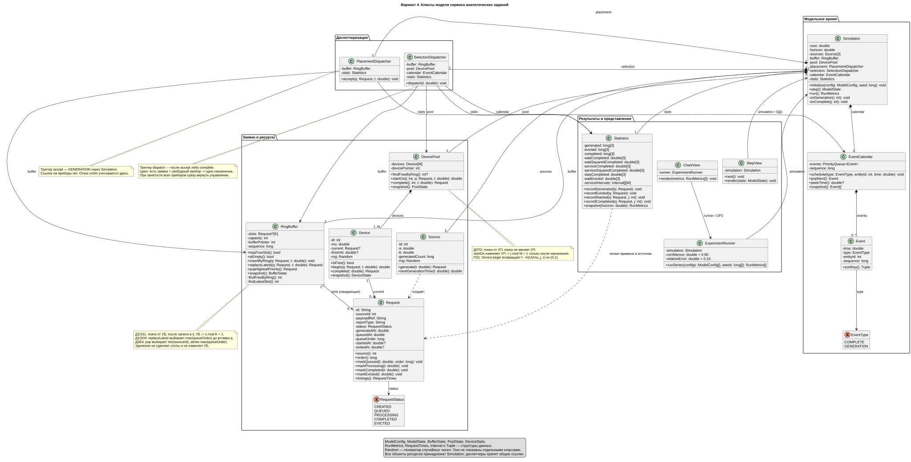
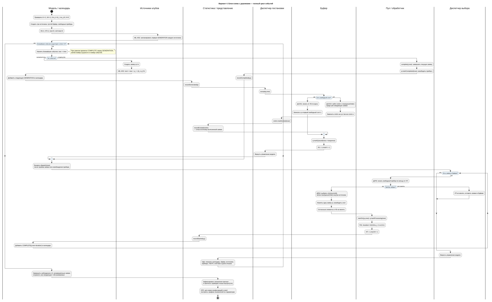
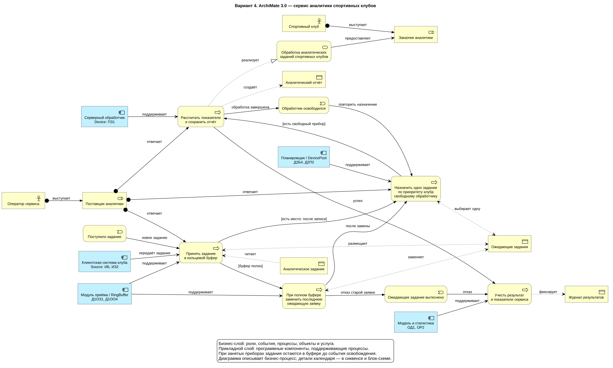

# Первичные артефакты. Сервис обработки аналитических заданий спортивных клубов

**Вариант 4 · Добров М. Г. · группа 5130904/40106**

Код: **ИБ ИЗ2 ПЗ1 Д1ОЗ1 Д1ОО4 Д2П2 Д2Б4 ОР2 ОД1**.

## 1. Назначение и функция верхнего уровня

Принять аналитическое задание спортивного клуба, поместить его в ограниченный кольцевой буфер, при переполнении вытеснить последнюю ранее принятую ожидающую заявку, выбрать одно задание по приоритету клуба, назначить свободному обработчику по кольцу, рассчитать отчёт и учесть результат.

Исходные данные — результаты матчей и тренировок. Продукт обслуживания — аналитический отчёт. Выход по отказу — отменённое ожидающее задание без отчёта. Случайная длительность обслуживания заменяет внутренний алгоритм расчёта статистики.

## 2. Окружение функции

| Категория | Артефакт / участник | Назначение |
|---|---|---|
| Входной документ | Задание на аналитический отчёт | Номер клуба, идентификатор i.k, тип отчёта, ссылка на исходные данные |
| Данные | Массив слотов буфера и УБ | Размещение ожидающих заданий без сдвига элементов |
| Данные | Состояние приборов и УП | Текущие задания, времена завершения, начало кольцевого поиска |
| Данные | Календарь событий | GENERATION и COMPLETE, упорядоченные по времени |
| Выходной документ | Готовый аналитический отчёт | Результат выполненного задания |
| Выходной документ | Запись о вытеснении | Идентификатор задания, клуб и время отказа |
| Выходной документ | Протокол шага ОД1 | Календарь, буфер, источники, приборы, указатели и показатели |
| Выходной продукт | Графики ОР2 | Сравнение конфигураций модели по параметрам |
| Исполнитель | Клиентские системы клубов | Три независимых источника И1, И2, И3 |
| Исполнитель | Модуль приёма | Размещение задания, инициирование вытеснения |
| Исполнитель | Планировщик заданий | Выбор заявки и свободного обработчика |
| Исполнитель | Серверные обработчики | Расчёт отчёта; одновременно одна заявка на прибор |
| Пользователь | Оператор сервиса | Задаёт параметры, наблюдает шаги и сравнивает графики |
| Программный компонент | Simulation / EventCalendar | Модельное время и запуск обработчиков событий |
| Программный компонент | Statistics / StepView / ChartView | Учёт результатов, пошаговое представление и графики |

Перечень описывает проектируемую систему. Программные компоненты на этом этапе представлены на диаграмме классов.

## 3. Дисциплины варианта

| Код | Формальное правило | Бизнес-смысл |
|---|---|---|
| ИБ | Следующая генерация планируется независимо от обслуживания предыдущей заявки | Клуб продолжает отправлять задания |
| ИЗ2 | Δtᵢ = aᵢ + (bᵢ − aᵢ)·U, U ∈ [0,1) | Равномерные интервалы отправки |
| ПЗ1 | τⱼ = −ln(U)/μⱼ, U ∈ (0,1) | Экспоненциальное время обработки |
| Д1ОЗ1 | Обход K слотов от УБ, запись в первый свободный s, УБ := s mod K + 1 | Кольцевое размещение заданий |
| Д1ОО4 | В полном буфере заменить заявку с максимальным queueOrder среди уже ожидающих | Отказ последнему ранее принятому заданию |
| Д2П2 | Обход M приборов от УП, назначение первому свободному j, УП := j mod M + 1 | Кольцевое распределение нагрузки |
| Д2Б4 | Минимальный sourceId, внутри него максимальный queueOrder; одна заявка | И1 > И2 > И3; последняя заявка клуба первой |
| ОД1 | Календарь событий, буфер, текущее состояние | Наблюдение каждого шага |
| ОР2 | Графики характеристик по значениям параметров | Исследование конфигураций сервиса |

Нормализована запись кодов: в извлечённом тексте пособия буквы «З» и «О» иногда выглядят как цифры «3» и «0». В образце варианта 4 в приложении 4 отдельно указано: среди заявок одного приоритета выбирается последняя поступившая. Это правило сохранено в соответствии с пользовательским бизнес-доменом и маппингом.

## 4. Данные и ограничения

В базовой модели три источника, K мест буфера и M приборов. Требуется `K ≥ 1`, `M ≥ 1`, `0 < aᵢ ≤ bᵢ`, `μⱼ > 0`, горизонт наблюдения `H > 0`. Значения K, M, параметров поступления и обслуживания задаются при проведении экспериментов.

Слоты и приборы нумеруются с 1. Изначально УБ = 1, УП = 1, буфер пуст, приборы свободны. После позиции K или M поиск продолжается с 1. Обход ограничен K или M проверками.

У заявки есть состояния CREATED → QUEUED → PROCESSING → COMPLETED либо CREATED → QUEUED → EVICTED. Идентификатор i.k уникален внутри прогона. Глобальный монотонный queueOrder назначается при каждой записи в буфер и однозначно задаёт порядок поступления при совпадении временных отметок.

Последняя заявка определяется по queueOrder, а не по индексу слота или УБ. Вытесняемая заявка определяется до вставки новой. При замещении новая занимает тот же слот s, после чего УБ становится следующим за s. Удаление для обслуживания оставляет свободное место и не изменяет УБ. При полном буфере приоритет источника не влияет на выбор жертвы отказа.

Буфер общий для всех клубов. Деление на зоны не требуется вариантом и ограничивало бы доступную ёмкость для отдельных источников; зонная организация может быть предметом отдельного эксперимента.

## 5. Взаимодействие компонентов и модельное время

Simulation владеет ресурсами и общими экземплярами диспетчеров, календаря и статистики. PlacementDispatcher хранит ссылки на RingBuffer и Statistics. SelectionDispatcher хранит ссылки на тот же RingBuffer, DevicePool, EventCalendar и Statistics. Объекты общие, отдельные копии буфера у диспетчеров не создаются.

Событие GENERATION вызывает Source.generate, учёт генерации, планирование следующего поступления и PlacementDispatcher.accept. Все заявки записываются в буфер. После завершения accept модель вызывает SelectionDispatcher.dispatch в тот же момент времени.

Событие COMPLETE завершает текущую заявку прибора, освобождает его и фиксирует обслуживание. Затем модель вызывает dispatch. Пока буфер не пуст и найден свободный прибор, выполняется одно назначение за итерацию: выбрать заявку, освободить её слот, занять прибор, передвинуть УП, учесть начало и запланировать COMPLETE.

findFreeByRing не изменяет УП. Указатель изменяется только при успешном startOn. При занятости всех приборов диспетчер возвращает управление. Источники продолжают генерировать, а модель переходит к ближайшему событию календаря. Активное ожидание или блокировка генерации отсутствуют.

Порядок событий задаётся ключом `(time, typePriority, entityId, sequence)`, где COMPLETE имеет приоритет 0, GENERATION — 1. Внутри типа сначала меньший номер источника/прибора, затем номер события. Обработчик события вместе с последующим dispatch выполняется атомарно. Это проектное правило для совпадающих времён; оно обеспечивает воспроизводимость.

После каждого события и dispatch система находится в устойчивом состоянии: если в буфере есть заявки, все приборы заняты. Поэтому при приходе к полному буферу приборы также заняты. Диспетчеру постановки не нужно проверять приборы.

## 6. Сиквенс-диаграммы

Общий сиквенс показывает инициализацию и цикл особых событий, приём, альтернативы свободного и полного буфера, вытеснение, завершение обслуживания, кольцевой выбор прибора, приоритетную выборку и сбор статистики. Запрашиваемые результаты показаны пунктирными обратными сообщениями.

Исходник: [sequence.puml](diagrams/sequence.puml).

HappyFlow: буфер и прибор свободны. Заявка проходит через буфер и начинает обслуживание в тот же момент времени, поэтому время ожидания равно нулю. Следующая генерация источника планируется независимо от завершения обслуживания.

Исходник: [sequence-happy.puml](diagrams/sequence-happy.puml).

Переполнение: при K=3, M=2 и занятых приборах новая 3.6 заменяет 1.7 как последнюю ранее вставленную. Отказ засчитывается И1. После освобождения П2 из буфера выбирается 2.4: И2 приоритетнее И3. Это продолжение одного сценария от отказа до постановки одной заявки на прибор.

Исходник: [sequence-overflow.puml](diagrams/sequence-overflow.puml).

Выбор: при УП=2, занятом П2 и свободных П1/П3 первым выбирается П3. Из заявок И1 выбирается последняя 1.2, затем на следующей итерации в тот же момент — 1.1 для П1. Это два отдельных назначения, а не пакет. Для изолированной проверки dispatch состояние задано искусственно: оно не описывает устойчивый снимок обычного прогона, поскольку при ожидающих заявках свободные приборы сразу занимались бы диспетчером.

Исходник: [sequence-selection.puml](diagrams/sequence-selection.puml).

## 7. Диаграмма классов

Диаграмма фиксирует приватные поля, методы с аргументами и результатами, владение объектами и ссылки между участниками. Request передаётся в методы размещения и обслуживания как объект. Структуры результатов и снимков перечислены в легенде, чтобы не перегружать схему второстепенными типами.

Исходник: [classes.puml](diagrams/classes.puml).

## 8. Блок-схема с дорожками

Дорожки разделяют модель/календарь, источники, приём, буфер, выбор, приборы и статистику. Показаны альтернативы генерации и завершения, свободного и полного буфера, наличия заявок и свободных приборов, а также завершение наблюдения. Переход к следующему событию позволяет показать ожидание без блокировки остальных источников.

Исходник: [flowchart.puml](diagrams/flowchart.puml).

## 9. Бизнес-процесс ArchiMate 3.0

Дополнительная схема показывает роли заказчика и поставщика, входное задание, приём в очередь, отказ при переполнении, назначение, расчёт отчёта и учёт результата. Прикладные компоненты поддерживают соответствующие бизнес-процессы. Технические детали порядка событий представлены в других диаграммах.

Исходник: [archimate.puml](diagrams/archimate.puml).

## 10. Статистика, цели и представление

Горизонт наблюдения — [0,H]. Обрабатываются события с time ≤ H; после этого незавершённые задания остаются в состоянии QUEUED или PROCESSING. Их не считают отказанными либо обслуженными. Доработка очереди после H в этой версии модели не предусмотрена.

| Показатель | Определение |
|---|---|
| Вероятность отказа источника i | Число вытесненных заявок Иi / число сгенерированных заявок Иi |
| Общая вероятность отказа | Сумма вытесненных / сумма сгенерированных; при нулевом знаменателе — «нет данных» |
| Среднее ожидание обслуженных | Среднее `startedAt − queuedAt` по завершённым заявкам |
| Среднее обслуживание | Среднее `exitedAt − startedAt` по завершённым заявкам |
| Дисперсия ожидания | Выборочная дисперсия `startedAt − queuedAt` по завершённым заявкам, отдельно по источникам |
| Дисперсия обслуживания | Выборочная дисперсия `exitedAt − startedAt` по завершённым заявкам, отдельно по источникам |
| Среднее пребывание обслуженных | Среднее `exitedAt − generatedAt` по завершённым заявкам |
| Ожидание вытесненных | Среднее `exitedAt − queuedAt` по вытесненным; показывается отдельно |
| Загрузка прибора j | Длина пересечения интервалов его занятости с [0,H], делённая на H |
| Незавершённые заявки | Число ожидающих и обслуживаемых в момент H |

При нулевом числе заявок в выборке среднее не определено. Для выборочной дисперсии используется знаменатель n−1; при n<2 она не определена. Statistics накапливает суммы времён ожидания/обслуживания и их квадратов отдельно по источникам. Средние времена завершённых заявок не включают вытесненные и незавершённые: в результатах обязательно указывается объём каждой выборки. Загрузка учитывает также часть незавершённого обслуживания до H. Для статистики по источникам и системе используется одинаковое правило.

Контроль баланса после каждого события: `сгенерировано = обслужено + вытеснено + в буфере + на приборах`. На одном приборе не больше одной заявки; одна заявка не может одновременно находиться в буфере и на приборе.

Для ОД1 показываются: текущее событие и время, будущий календарь, идентификаторы в слотах, УБ и УП, текущие заявки приборов и время их завершения, ближайшие генерации источников, сгенерировано/обслужено/вытеснено, доля отказов и текущая занятость.

Для ОР2 проектируются серии прогонов с изменением K, M или интенсивности поступления. Для интенсивности используется масштаб c: интервалы `[aᵢ/c,bᵢ/c]`, c>0. При изменении одного параметра остальные фиксируются; для каждой точки выполняются повторения с указанными seed. Графики показывают вероятность отказа, средние времена и загрузку; по источникам выводятся отдельные кривые. Численные результаты этого этапа отсутствуют: эксперименты выполняются после реализации программы.

Для итоговых экспериментов пособие требует относительную точность 10% и доверительную вероятность 0,9. Эти целевые параметры указаны у ExperimentRunner. При реализации потребуется оценивать доверительные интервалы по независимым повторениям и обосновывать число прогонов; при нулевых или близких к нулю оценках отдельно оговаривать абсолютную погрешность. На этапе первичных артефактов достижение точности не утверждается.

Ориентиры из памятки: доля отказов не выше 10%, загрузка около 90%, минимальное время пребывания среди подходящих конфигураций. Это критерии будущего сравнения, а не уже достигнутые значения. При несовместимости ориентиров нужно показать компромисс. Стоимость расчёта и эксплуатации обработчиков потребуется для экономического обоснования итогового отчёта.

## 11. Соответствие требованиям

| Требование памятки | Где отражено |
|---|---|
| Один общий сиквенс с альтернативами и циклами | sequence.puml |
| HappyFlow | sequence.puml, sequence-happy.puml |
| Занятые приборы, переполнение, отказ и дальнейшая обработка | sequence-overflow.puml |
| Постановка и выборка по своему варианту | Все сиквенсы, flowchart.puml |
| Расшифровки кодов на сиквенсах | Заметки и сообщения диаграмм |
| Возвраты запрошенных значений | Пунктирные сообщения сиквенсов |
| Явные триггеры диспетчеров | GENERATION → accept; accept/COMPLETE → dispatch |
| Методы и ссылки классов, инкапсуляция | classes.puml |
| Блок-схема с дорожками и альтернативами | flowchart.puml |
| ArchiMate, по желанию | archimate.puml |
| ОД1 и ОР2 именно для варианта 4 | Классы, общий сиквенс, блок-схема, раздел 10 |

Временная диаграмма не включена: памятка прямо говорит «Визуализировать временную диаграмму не нужно», хотя в общем пособии она встречается. Это решение касается временной диаграммы; сиквенс-диаграммы подготовлены полностью.

## 12. Основания и примеры оформления

Пользовательские документы: «Бизнес-домен_ДобровМГ_5130904-40106.docx», «Маппинг_ДобровМГ_5130904-40106.docx». Учебные требования: «СМО_памятка_к_упражнениям.txt», «СМО_пособие_2025.docx» (дисциплины в приложении 3, пример варианта 4 в приложении 4), «Пример_сиквенса_plantuml.txt».

Изучены предоставленные примеры: [APS, этап 2](https://github.com/nepolx/APS/tree/main/step2), [greenhouse, первичные артефакты](https://github.com/Aapng-cmd/greenhouse/blob/main/docs/primary-artifacts.md), [СМО, вариант 20](https://github.com/MoneyprogerISG/smo-variant-20), [BANK](https://github.com/TimeouTplz/BANK), [СМО, вариант 13](https://github.com/dsctannie/SMO_Variant13).

Использован общий подход к оформлению: исходники PlantUML, готовые рисунки, расшифровка варианта, методы и связи классов, дорожки процесса и отдельные ключевые сценарии. Дисциплины и бизнес-сущности других вариантов не переносятся в вариант 4.
